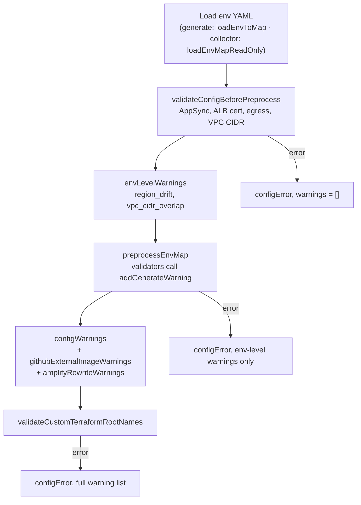

# Configuration warnings

**Last updated**: 2026-11-17 · **Applies to**: meroku after v6.5.0 (`app/config_warnings.go`)

A configuration warning is something in the env YAML worth fixing that does not stop
`meroku generate`. meroku reports the same list in three places: the output of `generate`, the
web UI canvas, and a confirmation screen before a TUI deploy. An error is different: it stops
generate, and nothing here turns one into the other.

## What a warning looks like

A service with `network_access: internal` and no `health_check_command` produces one warning.
`meroku generate dev` prints it and carries on:

```
⚠️  service 'orders-worker' is network_access: internal and has no health_check_command
   It is not behind the ALB, so nothing health-checks it: ECS replaces a task only
   when its process exits. Add a health_check_command that uses a tool the image
   really has. Slim and distroless images usually have no wget or curl; probe with
   the runtime instead, or copy the Dockerfile's HEALTHCHECK.
   Docs: https://github.com/MadAppGang/meroku/blob/main/ai_docs/SERVICE_NETWORK_ACCESS.md#check-that-the-tool-is-in-the-image

```

The web UI reads the same warning from the API:

```bash
curl -s 'http://localhost:8080/api/config-warnings?env=dev'
```

```json
{
  "env": "dev",
  "warnings": [
    {
      "code": "service_no_health_check",
      "item": { "kind": "service", "name": "orders-worker" },
      "title": "service 'orders-worker' is network_access: internal and has no health_check_command",
      "detail": "It is not behind the ALB, so nothing health-checks it: ECS replaces a task only\nwhen its process exits. ...",
      "docs": "https://github.com/MadAppGang/meroku/blob/main/ai_docs/SERVICE_NETWORK_ACCESS.md#check-that-the-tool-is-in-the-image"
    }
  ]
}
```

A clean YAML returns `{"env":"dev","warnings":[]}`. The port is whichever one the web server
printed at start (8080 when free).

### Warning, refusal or notice

| Kind | Effect on generate | Where it is produced | Reported as |
|---|---|---|---|
| Refusal (error) | Stops it, exit 1 | `validateConfigBeforePreprocess`, `preprocessEnvMap`, `validateCustomTerraformRootNames` | `configError` in the API, an error from generate |
| Warning | None | `addGenerateWarning` during preprocessing, plus the env-level and post-preprocessing sources | `ConfigWarning` |
| Notice | None | `addGenerateNotice` | Plain text from generate only |

A notice says what generate did on the user's behalf, for example the synthesised compute pool.
It is not a warning: the API, the web UI and the deploy screen never show notices.

## Type and codes

### The `ConfigWarning` type

```go
type ConfigWarning struct {
	Code   string      `json:"code"`           // stable rule id, snake_case
	Item   WarningItem `json:"item"`           // the part of the YAML it is about
	Title  string      `json:"title"`          // one line, no newline
	Detail string      `json:"detail"`         // full text, may contain "\n"
	Docs   string      `json:"docs,omitempty"` // absolute https URL or ""
}

type WarningItem struct {
	Kind string `json:"kind"`
	Name string `json:"name"`
}

type ConfigWarningReport struct {
	Env         string          `json:"env"`
	Warnings    []ConfigWarning `json:"warnings"`              // never nil, encodes as []
	ConfigError string          `json:"configError,omitempty"` // set when generate would refuse
}
```

Rules every report follows:

- `item.name` is the YAML name verbatim. An entry without a name gets `#<1-based index>`, for
  example `#3`.
- The singleton kinds `env`, `backend`, `valkey` and `event_bus` always have `name: ""`.
  `workloadItem` clears the name for them.
- `normalizeConfigWarnings` sorts and deduplicates. `env` items come first, then the order is
  `item.kind`, `item.name`, `code`, `detail`. Two warnings with the same code, item and detail
  become one.
- `docsLink("ai_docs/X.md")` builds the docs URL on the repository's `main` branch. The binary
  carries no version to pin a link to.

The TypeScript mirror is `web/src/types/configWarnings.ts`. The `WarningKind` union there must
list the same ten kinds as `warningKinds` in `app/config_warnings.go`. Its `EventWarningCode`
union lists every `event_*` code, including `event_ordered_shared_publishers`, which the Go side
defines but does not emit (`eventGroupsCarryPublisherAccount` is `true`).

### Warning codes

| Code | `item.kind` | Recorded in | In the API report |
|---|---|---|---|
| `region_drift` | `env` | `app/region_drift.go` | No: CLI and TUI only |
| `vpc_cidr_overlap` | `env` | `app/vpc_cidr_service.go` | Yes |
| `service_no_health_check` | `service` | `app/network_access.go` | Yes |
| `policy_wildcard_action` | `backend`, `service`, `scheduled_task`, `event_task` | `app/workload_policy.go` | Yes |
| `own_backend_bucket_env` | `service`, `scheduled_task`, `event_task` | `app/workload_env_reserved.go` | Yes |
| `event_subscription_all_types` | `backend`, `service`, `scheduled_task`, `event_task` | `app/events.go` | Yes |
| `event_produces_any` | `backend`, `service`, `scheduled_task`, `event_task` | `app/events.go` | Yes |
| `event_queue_unused` | `backend`, `service` | `app/events.go` | Yes |
| `event_bus_toggle` | `event_bus` | `app/events.go` | Yes |
| `event_bus_type_change` | `event_bus` | `app/events_enhanced.go` | Yes; the previous kind comes from the last main.tf's markers, because the report never reads state |
| `event_subscription_order_change` | `backend`, `service` | `app/events_enhanced.go` | Yes |
| `event_fifo_retired_unused` | `backend`, `service` | `app/events.go` | Yes |
| `event_queue_deleted` | `backend`, `service` | `app/events_enhanced.go` | No: needs Terraform state, which only generate and deploy read |
| `event_share_revoke` | `event_bus` | `app/events_enhanced.go` | Yes; the loss comes from the last main.tf's `share=` markers |
| `amplify_rule_disabled_workload` | `amplify_app` | `app/amplify_rewrites.go` | Yes |
| `amplify_rule_unreachable` | `amplify_app` | `app/amplify_rewrites.go` | Yes |
| `data_bucket_disabled_workload` | `data_bucket` | `app/data_bucket.go` | Yes |
| `valkey_access_disabled_workload` | `valkey` | `app/valkey.go` | Yes |
| `valkey_no_access` | `valkey` | `app/valkey.go` | Yes |
| `compute_pool_unused` | `compute_pool` | `app/compute_validation.go` | Yes |
| `compute_pool_spot_without_base` | `compute_pool` | `app/compute_validation.go` | Yes |
| `compute_pool_bridge_srv` | `compute_pool` | `app/compute_validation.go` | Yes |
| `backend_external_image_not_pushable` | `backend` | `app/github_external_image.go` | Yes |

The codes are constants (`warnCode*`) in `app/config_warnings.go`. Tests and the web UI key on
them, so a code never changes once released. Every compute pool title names the pool, because
all pools share one canvas node.

## Where warnings are computed



Two code paths walk this sequence:

- **`applyTemplate`** (`app/deploy.go`) is generate. It prints notices and warnings with
  `printGenerateNotices` and `printConfigWarnings` after `preprocessEnvMap`. When
  preprocessing refuses, it prints the env-level warnings and then returns the error.
- **`collectEnvConfigWarnings`** (`app/config_warnings.go`) is the offline collector behind
  the API and the deploy gate. It runs the same checks in memory and returns a
  `ConfigWarningReport`. It writes no file, prints nothing, and calls neither AWS nor the network.
  A panic inside preprocessing becomes `configError: "checking the configuration failed: ..."`.

`loadEnvMapReadOnly` (`app/migrations.go`) migrates an old-schema YAML in memory with
`io.Discard` as the output. It then marshals and unmarshals the result, so the values have the
types generate sees. A `schema_version` newer than the binary is a `configError`.

`preprocessEnvMap` never prints. Render tests and the collector call it, so the printing lives in
`applyTemplate`.

### Why `region_drift` is CLI and TUI only

`region_drift` compares the YAML `region` with the deploying shell's region, read from
`AWS_REGION` and the profile. The web server cannot answer that. It overwrites its own
`AWS_REGION` whenever an environment is selected in the UI, so the value it holds describes the
last selection, not a shell. `webWarningInputs` therefore sets `AmbientRegion` to nil and the API
report never contains the code. Generate and the deploy gate use `defaultWarningInputs`, which
keeps it.

## API: `GET /api/config-warnings?env=<name>`

Registered in `app/spa_server.go` behind `corsMiddleware`, handled by `getConfigWarnings` in
`app/api_config_warnings.go`. Each request reads the YAML from disk, so the GET after a save
shows the edit.

| Status | When | Body |
|---|---|---|
| 200 | The env exists | `ConfigWarningReport` |
| 400 | `env` missing or empty | `{"error": "env parameter is required"}` |
| 400 | Not an environment of the project | `{"error": "unknown environment: <name>"}` |
| 405 | Any method but GET | Plain text |
| 500 | Listing environments failed | `{"error": "..."}` |

An environment exists when `listEnvironmentNames` lists it, or when `<name>.yaml` or
`project/<name>.yaml` is a regular file. The second rule matters for a YAML that does not parse:
the listing drops it, yet the API answers 200 with `configError` and `warnings: []`. The names
`.`, `..` and `dns`, and any name containing `/` or `\`, are refused before a path is built.

The status stays 200 when generate would refuse the YAML; `configError` carries the reason:

| Cause | `warnings` |
|---|---|
| The YAML does not parse, or its `schema_version` is newer than the binary | `[]` |
| `validateConfigBeforePreprocess` refuses it | `[]` |
| `preprocessEnvMap` refuses it | `env`-kind warnings only |
| `validateCustomTerraformRootNames` refuses a custom Terraform file | The full list |

An `infrastructure/` directory older than the binary is not reported. It is not about the YAML.

## The TUI deploy gate

`meroku` → Deploy runs `deployWithGate(env, defaultDeployWarningGate(), run)` in `app/deploy.go`.
The gate decides before `run` migrates the file, writes `env/<env>/main.tf` or runs Terraform.
`deployWarningGate.allow` (`app/deploy_warning_gate.go`) applies these rules in order:

1. `configError` set: the deploy starts, and generate reports the error with the Claude Code
   handoff.
2. No warnings: the deploy starts and nothing is shown.
3. No terminal: the deploy starts without asking. `interactiveTerminal` is false when `CI` is
   set or stdin or stdout is not a TTY. Generate prints the warnings.
4. The user chooses "Proceed anyway": the deploy starts.
5. Anything else, including a screen that fails to start, prints
   `Deploy cancelled. Nothing ran.` and returns to the main menu.

The screen (`app/config_warnings_tui.go`) draws inline, not on the alternate screen. Under the
heading `⚠  N configuration warnings in <env>` it lists the item, title, detail and docs link of
every warning. Focus starts on "Cancel and fix".

| Key | Action |
|---|---|
| `←` `→` `h` `l` `tab` `shift+tab` | Move between the two buttons |
| `enter` | Choose the focused button |
| `p` | Proceed anyway |
| `esc` `q` `ctrl+c` | Cancel and fix |
| `↑` `↓` `k` `j` `pgup` `pgdown` | Scroll a list taller than the window |

On exit the screen clears itself and leaves plain text in the scrollback. Proceed leaves one
line, `Proceeding with N configuration warning(s) in <env>.`, and generate prints the full list
a moment later. Cancel prints the warnings through `printConfigWarnings`, so every docs link
stays whole for copying, followed by the cancel line. Colours come from `theme`, never
`lipgloss.Color`.

The web UI has no deploy. The TUI main-menu Deploy is the only entry point that shows this
screen before it generates anything.

## The web UI

`useConfigWarnings(env, refreshKey)` (`web/src/hooks/use-config-warnings.ts`) fetches the report:

- An env change fetches at once and drops the previous env's report.
- `App.tsx` bumps `refreshKey` after each successful save. The hook fetches 300 ms
  (`CONFIG_WARNINGS_DEBOUNCE_MS`) after the last bump.
- A new request aborts the previous one, and an answer from an older request id is dropped.
- A failed request keeps the last good report for the same env and logs to the console.

`warningNodeId` (`web/src/utils/configWarnings.ts`) maps an item to a canvas node id:

| `item.kind` | Node id |
|---|---|
| `backend` | `backend-service` |
| `service` | `service-<name>` |
| `scheduled_task` | `scheduled-<name>` |
| `event_task` | `event-<name>` |
| `amplify_app` | `amplify-<name>` |
| `compute_pool` | `ecs-cluster` |
| `valkey` | `valkey` |
| `data_bucket` | `s3` |
| `event_bus` | `eventbridge` |
| `env` | none |

Four components show the result:

| Surface | Component | What it shows |
|---|---|---|
| Canvas node | `ServiceNode.tsx` | Orange border, a count badge (`data-testid="node-warning-badge"`) above the instance badge, `data-warning="true"` |
| Sidebar | `ConfigWarningSection` in `ConfigWarningList.tsx` | Title, detail and docs link of each warning on the selected node, above every tab (`data-testid="node-warnings"`) |
| Over the canvas | `EnvWarningsPanel.tsx` | Warnings with no visible node, and `configError` (`data-testid="env-warnings"`, `aria-label="Environment warnings"`) |
| Status line | `ConfigWarningsStatus.tsx` | An "N warnings" button whose popover lists every warning by item (`data-testid="config-warnings-status"`) |

`DeploymentCanvas.tsx` places a warning on a node only when that node is visible and has the
React Flow type `service`. A warning about a hidden node, an unnamed `#N` entry, or a kind the UI
does not know goes to `EnvWarningsPanel` instead. The panel sits top-centre over the canvas,
collapses to one line, and renders nothing when there is nothing to show. Each row opens to the
detail. A docs link is rendered only for an absolute `https` URL (`safeDocsUrl`).

`data-warning="true"` appears on two elements. `ServiceNode` sets it on its own root div, and a
`useLayoutEffect` copies it onto the enclosing `.react-flow__node` wrapper (`rf__node-<id>`).
The installed `reactflow` 11 passes no custom attributes from node objects to that wrapper, so
`DeploymentCanvas` cannot set it there.

### Migrations write to the writer they are given

`Migration.Apply` has the signature `func(data map[string]interface{}, out io.Writer) error`,
and `applyMigrations(data, version, out)` passes `out` to each one. A migration prints with
`fmt.Fprintln(out, ...)`, never `fmt.Print*` or `os.Stdout`. A migration that writes to
stdout directly prints on the web server's console on every GET of an old-schema env, and over
the TUI deploy screen.

| Caller | `out` |
|---|---|
| `loadEnvWithMigration`, `meroku migrate` (`migrateFileIfNeeded`) | `os.Stdout` |
| `loadEnvReadOnly`, `loadEnvMapReadOnly` | `io.Discard` |

## Extending the checks

### How to add a warning

1. Pick a code. Add a `warnCode*` constant in `app/config_warnings.go` and a row to the codes
   table above.
2. Record it from the validator that finds it, inside `preprocessEnvMap`. Do not print it and do
   not return it as an error:

   ```go
   addGenerateWarning(envMap, ConfigWarning{
       Code:   warnCodeQueueRetentionShort,
       Item:   workloadItem(WarningKindService, name),
       Title:  fmt.Sprintf("service '%s' keeps queued events for under an hour", name),
       Detail: "events.queue.retention_seconds is 600. A consumer that is down for longer\nloses events. Set it to 3600 or more.",
       Docs:   docsLink("ai_docs/EVENTS.md"),
   })
   ```

   A source that needs the preprocessed map, as `githubExternalImageWarnings` does, returns
   `[]ConfigWarning` and is appended in `configWarnings`.
3. Use the existing kind for the item. For a new kind, add a `WarningKind*` constant and an
   entry in `warningKinds`. Then add it to the `WarningKind` union in
   `web/src/types/configWarnings.ts`, to `KNOWN_KINDS`, `warningNodeId` and `KIND_LABELS` in
   `web/src/utils/configWarnings.ts`, and to `warningItemLabel` in `app/config_warnings_tui.go`.
4. Add a test to `app/config_warnings_test.go` that runs `collectEnvConfigWarnings` on a
   synthetic YAML and asserts the code, item and title.

`warnCodeQueueRetentionShort` above is an illustration; no such rule exists.

### How to add a refusal

A check that should stop generate goes in `validateConfigBeforePreprocess` (`app/deploy.go`),
or returns an error from a validator inside `preprocessEnvMap`. Both generate and the collector
call these, so the API reports the refusal as `configError` with no extra code.

```go
func validateConfigBeforePreprocess(env string, envMap map[string]interface{}) error {
	if err := validateAppSyncConfigMap(envMap); err != nil {
		return err
	}
	// add the new check here, before the VPC CIDR check
	return validateVPCCIDRMap(env, envMap)
}
```

## Troubleshooting

**The API returns 400 `unknown environment` for an env that exists.** The handler looks for
`<name>.yaml` in the working directory of the web server and in `project/`. Start the server
from the project root.

**A warning appears in `generate` output but not in the web UI.** Check the code first.
`region_drift` is never in the API report, by design. Any other code is in the report; when its
node is hidden, the warning is in `EnvWarningsPanel` and in the status-line popover rather than on
the canvas.

**The deploy screen never appears in CI.** Rule 3 above: without a TTY, or with `CI` set, the gate
deploys without asking, and the warnings are in the generate output of the CI log.

**Migration text shows up on the API server's console.** A migration is printing with
`fmt.Print*`, so the `io.Discard` that the read-only loaders pass it never sees the output. Write
to `out`.

**The node shows no badge after a save.** Wait: the hook asks 300 ms after the last save. If
`GET /api/config-warnings` then returns the warning but the node still shows nothing, the node is
hidden or `warningNodeId` maps the item's kind to a different id; the warning is then listed in
`EnvWarningsPanel`.

## Limitations and files

### Limitations

- Warnings never stop `generate`, and `meroku generate` has no flag to treat them as errors.
- The web UI has no deploy and no "proceed" control. It shows warnings only.
- Docs links point at the `main` branch, not at the version of the running binary.
- Only nodes of React Flow type `service` carry a badge. All compute pools share the
  `ecs-cluster` node.

### Files

- `app/config_warnings.go`: types, codes, sorting, `printConfigWarnings`, the collector
- `app/api_config_warnings.go`: the HTTP handler and the environment existence check
- `app/deploy_warning_gate.go`, `app/config_warnings_tui.go`: the gate and its screen
- `app/workload_names.go`: `addGenerateWarning`, `generateWarnings`, `addGenerateNotice`
- `app/deploy.go`: `validateConfigBeforePreprocess`, `applyTemplate`, the main-menu deploy
- `web/src/hooks/use-config-warnings.ts`, `web/src/utils/configWarnings.ts`,
  `web/src/types/configWarnings.ts`
- `web/src/components/ServiceNode.tsx`, `EnvWarningsPanel.tsx`, `ConfigWarningList.tsx`,
  `ConfigWarningsStatus.tsx`, `DeploymentCanvas.tsx`
- `web/tests/e2e/config-warnings.spec.ts`: Playwright tests against the API contract

Related: [Validation rules catalog](./VALIDATION_RULES_CATALOG.md),
[Service network access](./SERVICE_NETWORK_ACCESS.md),
[Web app node properties](./WEB_APP_NODE_PROPERTIES.md), [Migrations](./MIGRATIONS.md).
